<h2>TensorFlow-FlexUNet-Image-Segmentation-Lung-Cancer-MRI (2026/11/02)</h2>
<h3>Lung-Cancer-MRI: AI Generated Pseudo Masks Segmentation Challenge</h3>
Sarah T. Arai 
Software Laboratory antillia.com  
This is the first experiment of Image Segmentation for <b>Lung-Cancer-MRI </b>
 based on
our <a href="https://github.com/sarah-antillia/TensorFlow-FlexUNet-Image-Segmentation-Model">TensorFlowFlexUNet Model</a>
 (<b>TensorFlow Flexible UNet Image Segmentation Model for Multiclass</b>) and a 512x512-pixel PNG
 <a href="https://drive.google.com/file/d/10UIC5Lg6zN5iR8iidYIbjHY5u4MlG1GL/view?usp=sharing">
Lung-Cancer-MRI-ImageMask-Dataset.zip</a> 
which was derived by us from the Kaggle  
  
<a href="https://www.kaggle.com/datasets/ajithdari/lung-cancer-genomic-and-clinical-dataset">
<b>Lung Cancer Genomic & Clinical Dataset</b>
</a>  
<b>Lung cancer MRI images with deterministic patient-level clinical features</b> 
by Mukesh Dilip.
  

<b>Actual Image Segmentation for Lung-Cancer-MRI Images of 512x512 pixels</b> 
As shown below, the inferred masks resemble the ground-truth masks.  
 
<table>
<tr>
<th width="320" height="auto">Input: image</th>
<th width="320" height="auto">Mask (ground_truth)</th>
<th width="320" height="auto">Prediction: inferred_mask</th>
</tr>
<tr>
<td>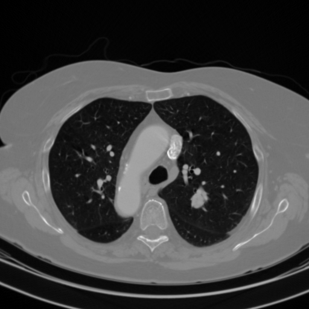</td>
<td></td>
<td></td>
</tr>
<tr>
<td>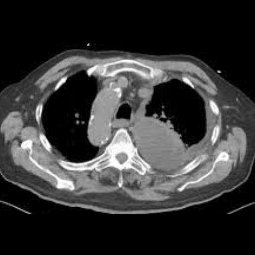</td>
<td></td>
<td></td>
</tr>
<tr>
<td>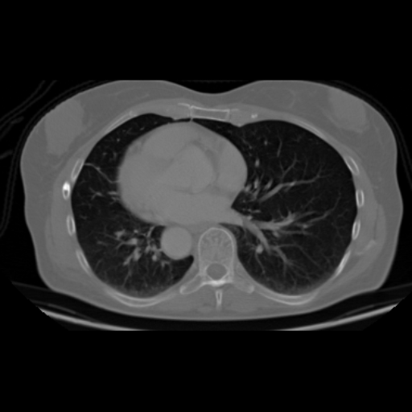</td>
<td></td>
<td></td>
</tr>
</table>

 
<h3>1. Dataset Citation</h3>
The dataset used here was derived from the following Kaggle:  
<a href="https://www.kaggle.com/datasets/ajithdari/lung-cancer-genomic-and-clinical-dataset">
<b>Lung Cancer Genomic & Clinical Dataset</b>
</a>  
<b>Lung cancer MRI images with deterministic patient-level clinical features</b> 
by Mukesh Dilip.
  
The following explanation was taken the website above.
  
<b>About Dataset</b> 
This dataset provides lung cancer MRI images along with associated clinical and 
genomic features for all patients. Each patient entry includes:
  
<b>Clinical Features:</b> 
Histological type (Adenocarcinoma, Squamous cell carcinoma, Large cell carcinoma, Small cell lung carcinoma)
  
Tumor grade (G1–G4)
  
Tumor tissue site, laterality, and tumor location
  
Patient demographics: age at initial pathology, gender, race, ethnicity
  
Mortality status (death01)
  
Gene Cluster Annotations:
  
TP53Cluster (TP53_1 to TP53_5)
  
EGFRCluster (EGFR_1 to EGFR_5)
  
CDKN2ACluster (CDKN2A_1α, CDKN2A_1β, CDKN2A_2)
 
KRAS G12C Cluster (KRAS G12C_2, KRAS G12C_3)
  
EML4-ALKCluster (EML4-ALK_1, EML4-ALK_3a, EML4-ALK_3b, EML4-ALK_2, EML4-ALK_5)
 
 
<b>License</b> 
Unknown
 
 
<h3>
2. Lung-Cancer-MRI ImageMask Dataset
</h3>
<h3>2.1 Download ImageMask Dataset</h3>
 If you would like to train this Lung-Cancer-MRI Segmentation model,
 please download the dataset from Google Drive  
 <a href="https://drive.google.com/file/d/10UIC5Lg6zN5iR8iidYIbjHY5u4MlG1GL/view?usp=sharing">
Lung-Cancer-MRI-ImageMask-Dataset.zip</a>. 
Expand the downloaded ImageMaskDataset and put it under the <b>./dataset</b> folder.
 
<pre>
./dataset
└─Lung-Cancer-MRI
    ├─test
    │   ├─images
    │   └─masks
    ├─train
    │   ├─images
    │   └─masks
    └─valid
         ├─images
         └─masks
</pre>
 
<b>Lung-Cancer-MRI Statistics</b> 
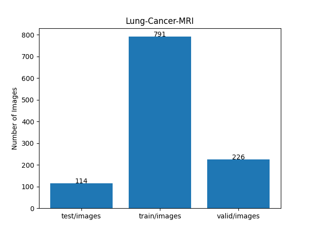 
 
As shown above, the number of images in the training and valid datasets is large enough to use for the
 training set of our segmentation model.
 
<h3>2.2 Derivation of ImageMask Dataset</h3>
The folder structure of the original dataset is as follows, but it contains no
annotation (mask) files.
<pre>
./lung_cancer_MRI_dataset
   └─train
       └─cancer (1,122 files)
         ├─LNG001.png
...
         └─LNG1122.png
</pre>
<b>Step 1</b> 
We generated a 512x512-pixel PNG master images from the image files in <b>cancer</b> folder.
  
<b>Step 2</b> 
We generated pseudo masks corresponding to the master images
by applying a segmentation (inference) method of the pretrained model 
<a href="TensorFlow-FlexUNet-Image-Segmentation-Lung-Cancer-CT">
TensorFlow-FlexUNet-Image-Segmentation-Lung-Cancer-CT
</a> to the master images.
  
<b>Step 3</b> 
We generated an augmented ImageMask dataset from the pseudo masks and the master images 
by applying flipping augmentation tools to all pairs of the images and masks.
  
<b>Step 4</b> 
We generated a new pretrained FlexUNet segmentation model by using the augmented ImageMask 
dataset derived at Step 3.
  
<b>Step 5</b> 
We generated a new pseudo masks corresponding to the master images by applying a segmentation method of the new 
pretrained FlexUNet model obtained at Step 4.
  
We iteratively repeated Steps 3 to 5 two times to generate our curated Lung-Cancer-MRI-ImageMask-Dataset.
  
<h3>2.3 Train Sample Images and Masks</h3>
<b>Train_sample_images</b> 
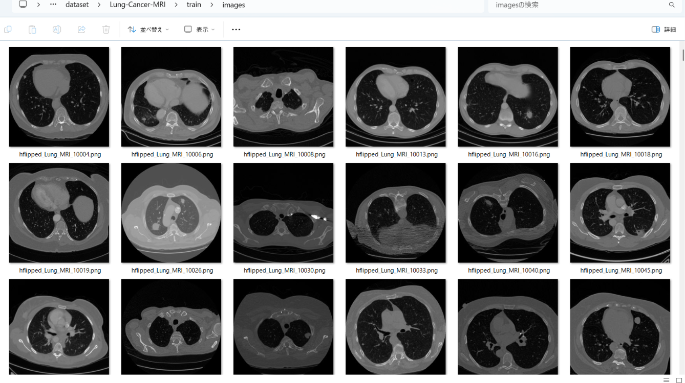
 
<b>Train_sample_masks</b> 
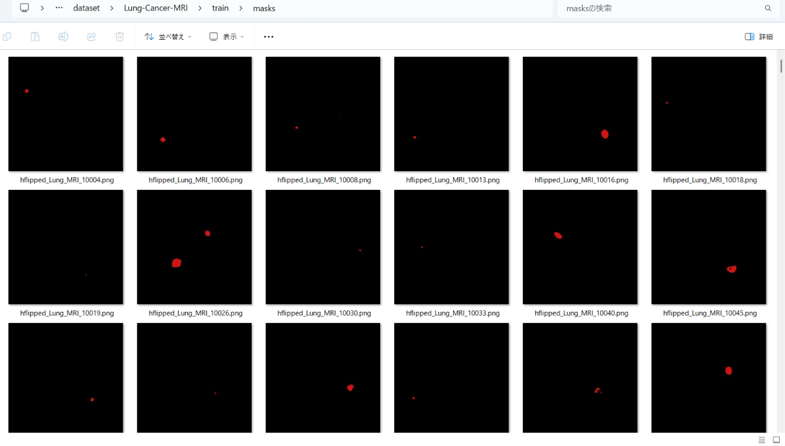
 
<h3>
3. Train TensorFlowFlexUNet Model
</h3>
 We trained the Lung-Cancer-MRI TensorFlowFlexUNet model using the following
<a href="./projects/TensorFlowFlexUNet/Lung-Cancer-MRI/train_eval_infer.config"> <b>train_eval_infer.config</b></a> file.  
Please move to ./projects/TensorFlowFlexUNet/Lung-Cancer-MRI and run the following bat file. 
<pre>
>1.train.bat
</pre>
This runs the following command. 
<pre>
>python ../../../src/TensorFlowFlexUNetTrainer.py ./train_eval_infer.config
</pre>

<b>Model parameters</b> 
Defined a small <b>base_filters=16 </b> and large <b>base_kernels=(11,11)</b> for the first Conv Layer of Encoder Block of 
<a href="./src/TensorFlowFlexUNet.py">TensorFlowFlexUNet.py</a> 
and a large <b>num_layers=8</b> (including a bridge between Encoder and Decoder Blocks).
<pre>
[model]
; You may specify your own UNet class derived from our TensorFlowFlexModel
model         = "TensorFlowFlexUNet"
generator     =  False
image_width    = 512
image_height   = 512
image_channels = 3
num_classes    = 2
base_filters   = 16
base_kernels   = (11,11)
num_layers     = 8
dropout_rate   = 0.03
dilation       = (1,1)
</pre>
<b>Learning rate</b> 
Defined a small learning rate.  
<pre>
[model]
learning_rate  = 0.00007
</pre>
<b>Loss and metrics functions</b> 
Specified "categorical_focal_dice_loss" and <a href="./src/dice_coef_multiclass.py">"dice_coef_hybrid"</a>. 
<pre>
[model]
loss           = "categorical_focal_dice_loss"
metrics        = ["dice_coef_hybrid"]
hybrid_alpha   = 1.6
hybrid_beta    = 0.4
</pre>
<b>Dataset class</b> 
Specifed <a href="./src/ImageCategorizedMaskDataset.py">ImageCategorizedMaskDataset</a> class. 
<pre>
[dataset]
class_name    = "ImageCategorizedMaskDataset"
</pre>
 
<b>Learning rate reducer callback</b> 
Enabled the learning_rate_reducer callback and a small reducer_patience.
<pre> 
[train]
learning_rate_reducer = True
reducer_factor     = 0.4
reducer_patience   = 4
</pre>
<b>Early stopping callback</b> 
Enabled early stopping callback with the patience parameter.
<pre>
[train]
patience      = 10
</pre>
<b>RGB Color map</b> 
Specified RGB color map dict for Lung-Cancer-MRI 2 classes. 
<pre>
[mask]
mask_datatype= "categorized"
mask_file_format = ".png"
; Lung-Cancer-MRI RGB color map dict for 1+1 classes.
;      Background: black,  Cancer:dark_red
rgb_map = {(0,0,0):0,(210,20,20):1,}
</pre>

<b>Epoch change inference callback</b> 
Enabled <a href="./src/EpochChangeInferencer.py">epoch_change_infer callback</a></b>. 
<pre>
[train]
epoch_change_infer       = True
epoch_change_infer_dir   =  "./epoch_change_infer"
num_infer_images         = 6
</pre>

By using this callback, on every epoch change, the inference procedure can be called
 for 6 images in the <b>mini_test</b> folder. This will help you confirm how the predicted mask changes 
 at each epoch during your training process.  
  

As shown below, early in the model training, the predicted masks from our FlexUNet segmentation model showed 
discouraging results.
 However, as training progressed through the epochs, the predictions gradually improved. 
   
 

<b>Epoch_change_inference output at starting (epoch 1,2,3)</b> 
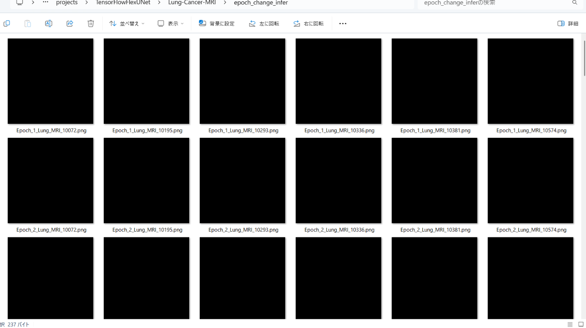 
 
<b>Epoch_change_inference output at middlepoint (epoch 17,18,19)</b> 
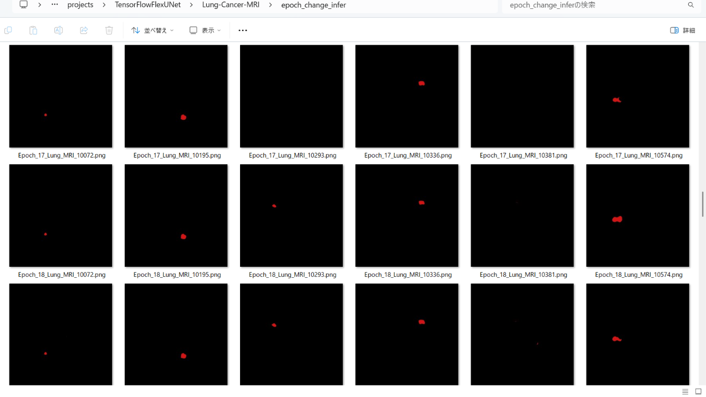 
 
<b>Epoch_change_inference output at ending (epoch 35,36,37)</b> 
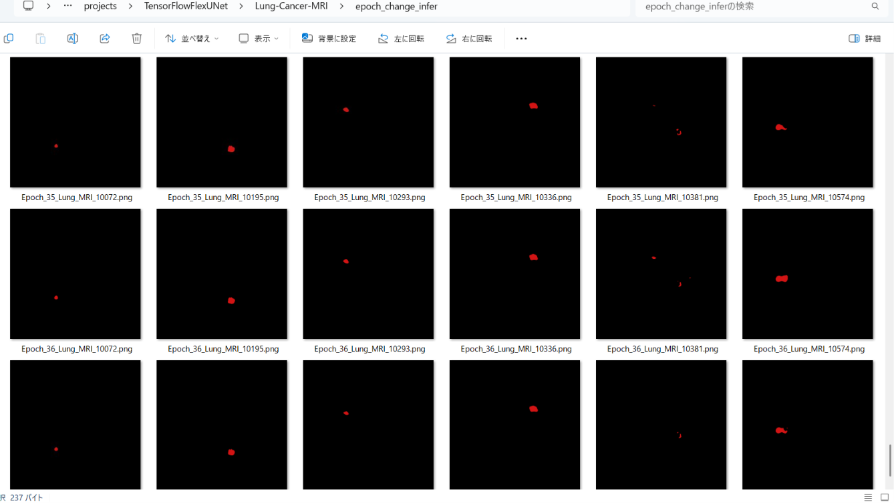 
 
In this experiment, the training process was stopped at epoch 37 by EarlyStoppingCallback. 
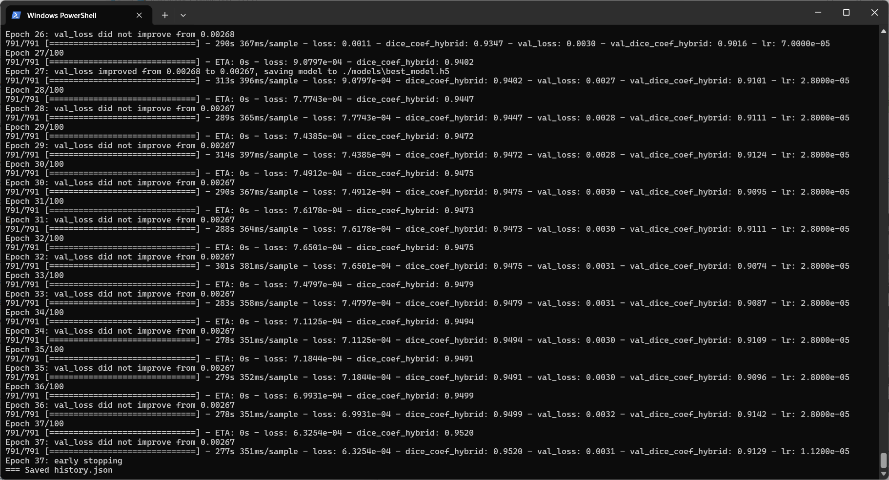 
 
<a href="./projects/TensorFlowFlexUNet/Lung-Cancer-MRI/eval/train_metrics.csv">train_metrics.csv</a> 
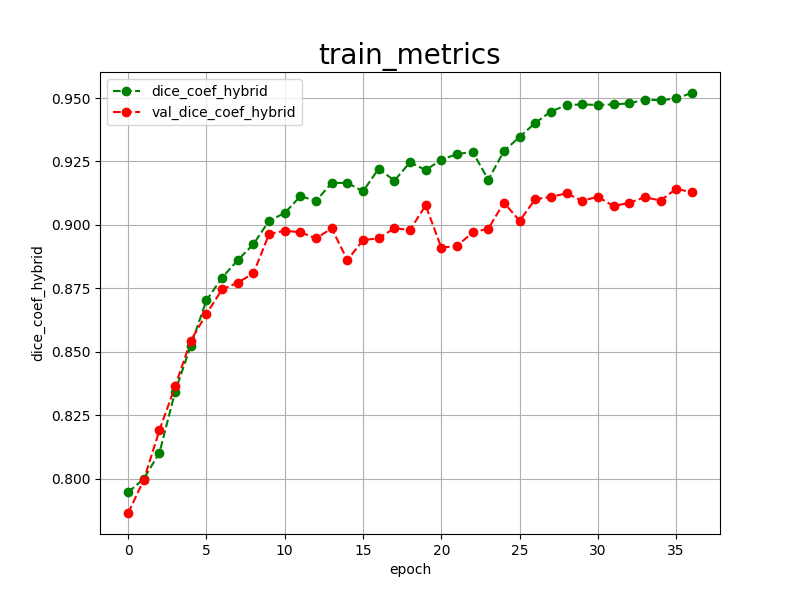 
 
<a href="./projects/TensorFlowFlexUNet/Lung-Cancer-MRI/eval/train_losses.csv">train_losses.csv</a> 
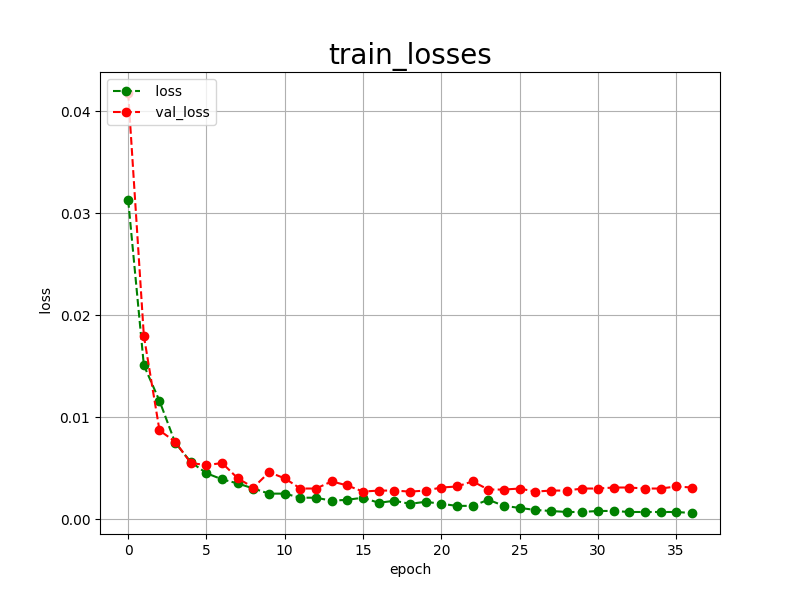 
 
<h3>
4. Evaluation
</h3>
Please move to <b>./projects/TensorFlowFlexUNet/Lung-Cancer-MRI</b> folder,
and run the following bat file to evaluate the TensorFlowUNet model for Lung-Cancer-MRI. 
<pre>
>./2.evaluate.bat
</pre>
This runs the following command.
<pre>
>python ../../../src/TensorFlowFlexUNetEvaluator.py ./train_eval_infer.config
</pre>

Evaluation console output: 
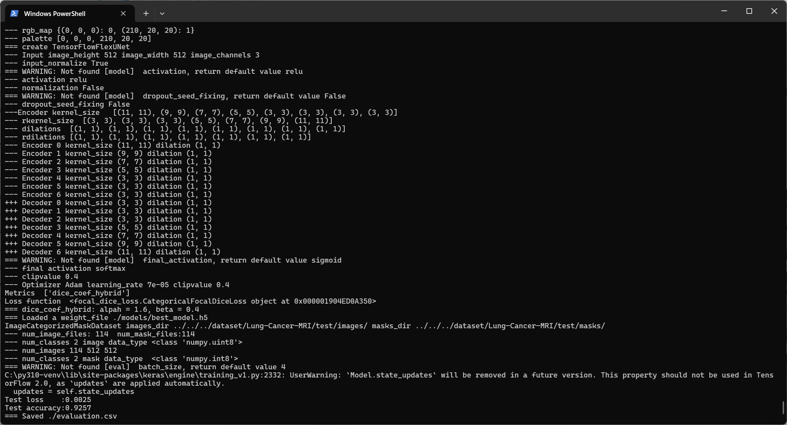
  Image-Segmentation-Lung-Cancer-MRI

<a href="./projects/TensorFlowFlexUNet/Lung-Cancer-MRI/evaluation.csv">evaluation.csv</a> 
The loss (categorical_focal_dice_loss) on this Lung-Cancer-MRI/test was very low, 
and dice_coef_hybrid was high, as shown below.
 
<pre>
categorical_focal_dice_loss,0.0025
dice_coef_hybrid,0.9257
</pre>
 
<h3>
5. Inference
</h3>
Please move to <b>./projects/TensorFlowFlexUNet/Lung-Cancer-MRI</b> folder
and run the following bat file to infer segmentation regions for images using the trained TensorFlowUNet model for Lung-Cancer-MRI. 
<pre>
>./3.infer.bat
</pre>
This runs the following command.
<pre>
>python ../../../src/TensorFlowFlexUNetInferencer.py ./train_eval_infer.config
</pre>

<b>mini_test_images</b> 
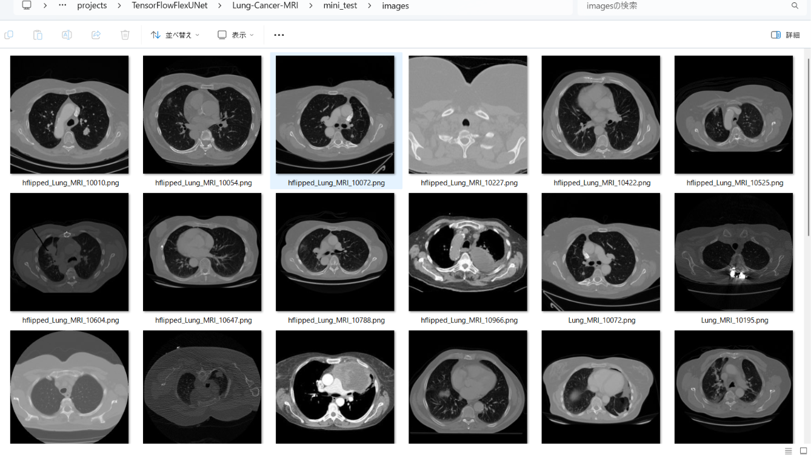 
<b>mini_test_mask(ground_truth)</b> 
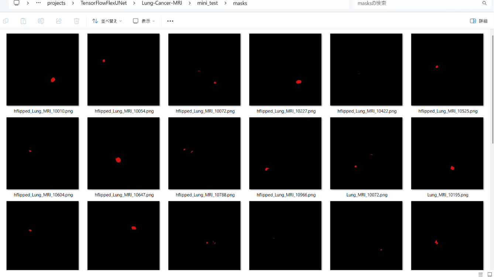 

<b>Inferred test masks</b> 
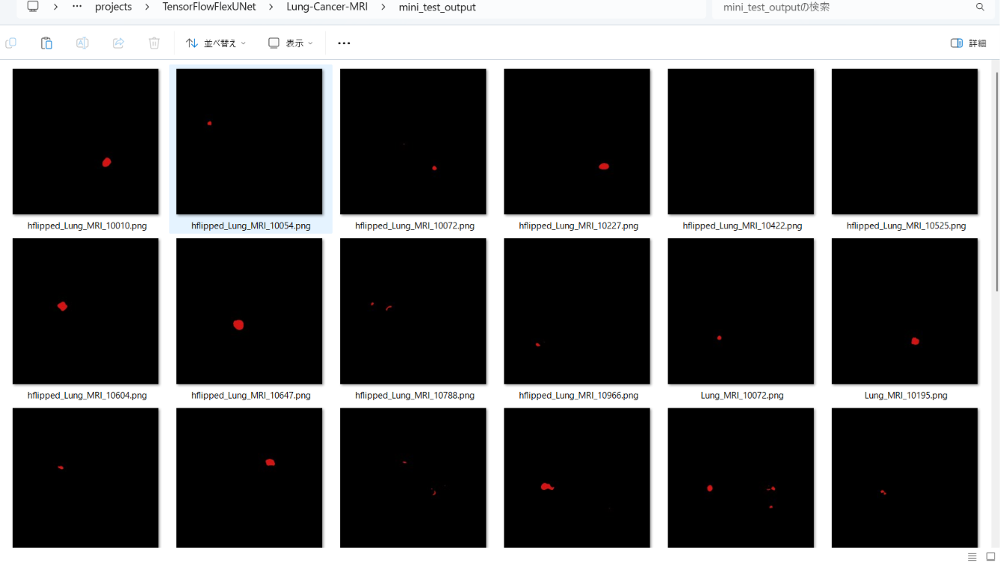 
 

<b>Enlarged images and masks for Lung-Cancer-MRI Images of 512x512 pixels</b> 
As shown below, the inferred masks look similar to the ground truth masks. 
 
<table>
<tr>
<th width="320" height="auto">Image</th>
<th width="320" height="auto">Mask (ground_truth)</th>
<th width="320" height="auto">Inferred-mask</th>
</tr>
<tr>
<td>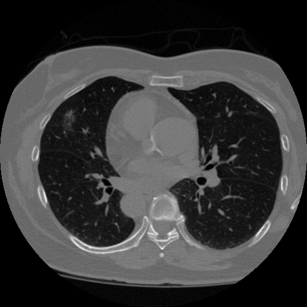</td>
<td></td>
<td></td>
</tr>
<tr>
<td></td>
<td></td>
<td></td>
</tr>
<tr>
<td>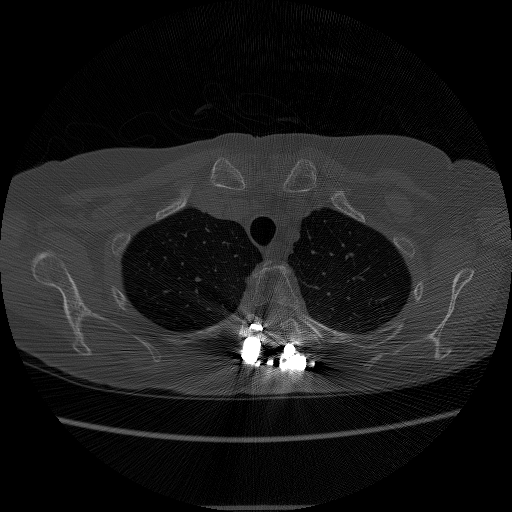</td>
<td></td>
<td></td>
</tr>
<tr>
<td>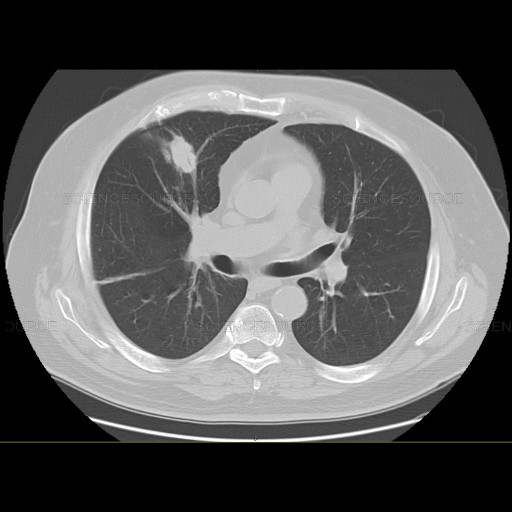</td>
<td></td>
<td></td>
</tr>
<tr>
<td>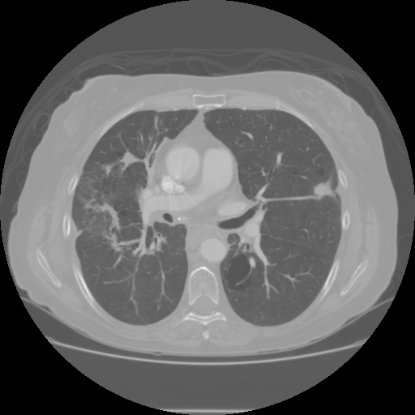</td>
<td>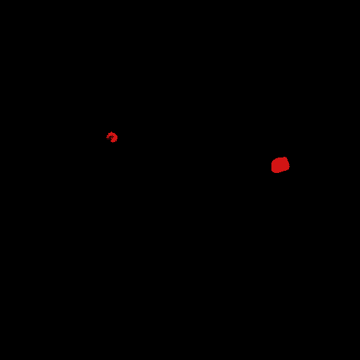</td>
<td>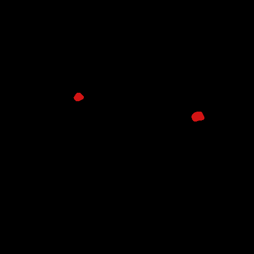</td>
</tr>
<tr>
<td>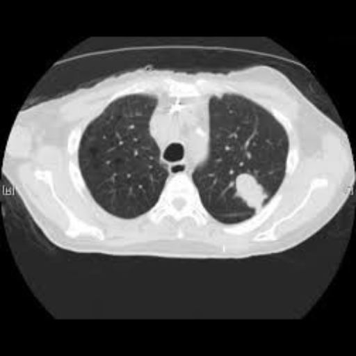</td>
<td></td>
<td></td>
</tr>
</table>

 
<h3>
References
</h3>
<b>1. Lung cancer segmentation dataset with Lung-RADS class</b> 
Nam, Diana; Panina, Alexandra; Pak, Alexandr  
(2024),  Mendeley Data, V1, doi: 10.17632/5rr22hgzwr.1  
<a href ="https://data.mendeley.com/datasets/5rr22hgzwr/1">
  https://data.mendeley.com/datasets/5rr22hgzwr/1
</a>
  
<b>2. Lung Tumor Image Segmentation from Computer Tomography Images Using MobileNetV2 and Transfer Learning</b> 
Zainab Riaz, Bangul Khan, Saad Abdullah, Samiullah Khan, Md Shohidul Islam 
<a href="https://pmc.ncbi.nlm.nih.gov/articles/PMC10451633/" >
  https://pmc.ncbi.nlm.nih.gov/articles/PMC10451633/
</a>
  
<b>3. NLSTseg: A Pixel-level Lung Cancer Dataset Based on NLST LDCT Images</b> 
Kun-Hui Chen, Yi-Hui Lin, Shawn Wu, Nai-Wen Shih, Hsing-Chen Meng, Yen-Yu Lin, Chun-Rong Huang & Jing-Wen Huang  
<a href ="https://www.nature.com/articles/s41597-025-05742-x">
https://www.nature.com/articles/s41597-025-05742-x
</a>
  
<b>4. TensorFlow-FlexUNet-Image-Segmentation-Smokers-Lung-Cancer-CT</b> 
Toshiyuki Arai 
<a href="https://github.com/sarah-antillia/TensorFlow-FlexUNet-Image-Segmentation-Smokers-Lung-Cancer-CT">
https://github.com/sarah-antillia/TensorFlow-FlexUNet-Image-Segmentation-Smokers-Lung-Cancer-CT
</a>
  
<b>5. TensorFlow-FlexUNet-Image-Segmentation-Lung-Cancer-CT</b> 
Toshiyuki Arai 
<a href="https://github.com/sarah-antillia/TensorFlow-FlexUNet-Image-Segmentation-Lung-Cancer-CT">
https://github.com/sarah-antillia/TensorFlow-FlexUNet-Image-Segmentation-Lung-Cancer-CT
</a>
  
<b>6. TensorFlow-FlexUNet-Image-Segmentation-Model</b> 
Toshiyuki Arai 
<a href="https://github.com/sarah-antillia/TensorFlow-FlexUNet-Image-Segmentation-Model">
https://github.com/sarah-antillia/TensorFlow-FlexUNet-Image-Segmentation-Model
</a>
  
